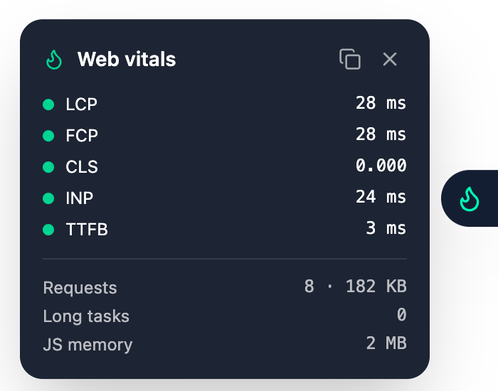

# nuxt-vitals-panel

[](https://www.npmjs.com/package/nuxt-vitals-panel)
[](https://www.npmjs.com/package/nuxt-vitals-panel)
[](https://github.com/kendrick-k/nuxt-vitals-panel/actions/workflows/ci.yml)
[](https://github.com/kendrick-k/nuxt-vitals-panel/blob/main/LICENSE)
[](https://nuxt.com)
[](https://tailwindcss.com)

A small flame button on the edge of your Nuxt page. Click it to open a live **Core Web Vitals** panel (LCP, FCP, CLS, INP, TTFB), copy a JSON report, and ship it to production for admins only.



The flame is green when every metric is good, amber when the worst one needs improvement, red when any is poor, and grey while nothing is measured yet.

- Measures with Google's [`web-vitals`](https://github.com/GoogleChrome/web-vitals) library, so LCP, CLS and INP are computed the way Google does.
- Shows requests, transferred size, long tasks and JS memory.
- Warns when the numbers can't be trusted (page loaded in a background tab, development mode). Warnings stay behind a button until you click it.
- One click copies a JSON report (URL, date, values, ratings) for a bug report or a ticket.
- Hidden in production unless you allow it, for example for admins. Nothing is measured while the panel is hidden.
- No icon library: inline SVG. Styled with Tailwind CSS 4.

## Install

```bash
npx nuxt module add nuxt-vitals-panel
```

or `npm i nuxt-vitals-panel` and add it to `modules`:

```ts
// nuxt.config.ts
export default defineNuxtConfig({
  modules: ['nuxt-vitals-panel'],
})
```

### Tailwind CSS 4

Tailwind ignores `node_modules` by default, so tell it to scan the panel's classes once:

```css
/* app/assets/css/main.css */
@import "tailwindcss";
@source "../../../node_modules/nuxt-vitals-panel/dist/runtime";
```

(Adjust the relative path to your CSS file.)

## Use

```vue
<!-- app.vue -->
<template>
  <NuxtPage />
  <VitalsPanel />
</template>
```

In development the panel is always shown. In production it is hidden unless you pass `allow`:

```vue
<script setup lang="ts">
const { isAdmin } = useMyAuth() // your own check
</script>

<template>
  <VitalsPanel :allow="isAdmin" />
</template>
```

| Prop | Default | |
| --- | --- | --- |
| `allow` | `false` | Show the panel in production |
| `position` | `'right'` | `'right'` or `'left'` edge (also a module option: `vitalsPanel: { position: 'left' }`) |

`useVitals()` returns the live `vitals` state and `start()` if you want to build your own display.

## Notes

- Values describe the page as loaded, not each client-side navigation.
- Development builds serve hundreds of modules, so measure on a production build.
- A page opened in a background tab is not painted by the browser, so LCP and FCP are not reported until you reload it in front.
- `allow` only hides the panel. The numbers are the visitor's own browser performance data, not secrets, but don't rely on it for access control.

## Development

```bash
npm install
npm run dev:prepare
npm run dev        # playground
npm test
npm run prepack    # build the module
```

## License

MIT

## More from the same maker

- [CMPKit](https://cmpkit.com): consent management for your website.
